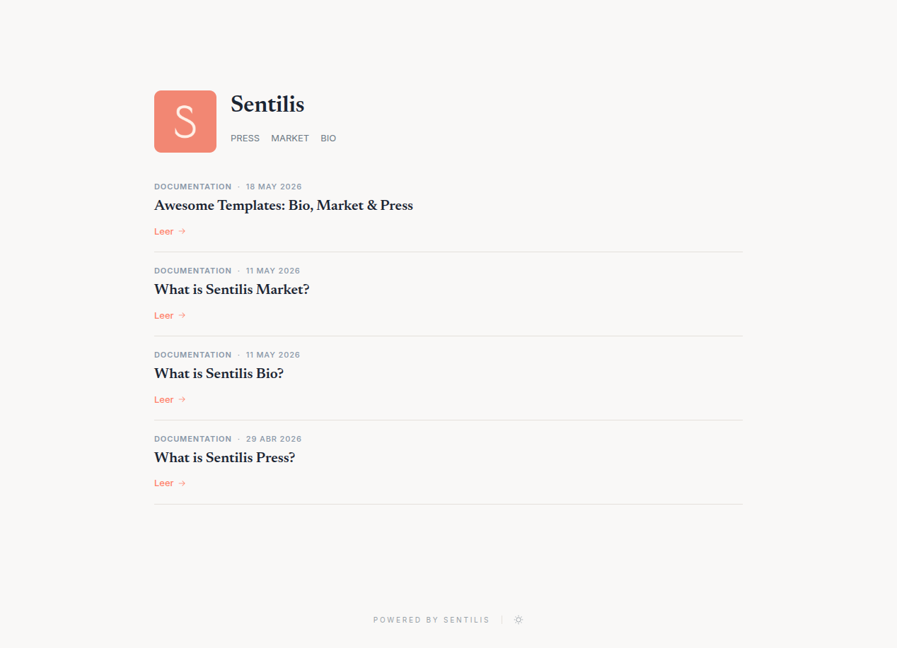

<p align="center">
  <h1 align="center">@sentilis/cli</h1>
</p>

<p align="center">
  <strong>The official command-line interface for the Sentilis platform.</strong>
</p>

<p align="center">
<a href="https://www.npmjs.com/package/@sentilis/cli" target="_blank"></a>
<a href="https://www.npmjs.com/package/@sentilis/cli" target="_blank"></a>
<a href="https://www.npmjs.com/package/@sentilis/cli" target="_blank"></a>
</p>


> How your entry looks on Sentilis. [See it live →](https://sentilis.me/en)

## Description

The **Sentilis CLI** is a powerful tool designed to seamlessly bridge your local development workflow with the Sentilis platform. It enables you to confidently validate, manage, and push content directly from your terminal using simple, trackable Markdown files.

The validation and publishing logic the CLI is built on is the isomorphic SDK, published separately as [`@sentilis/sdk`](https://www.npmjs.com/package/@sentilis/sdk). Use it directly when you want to drive the same logic from your own code. See [Use as a library](#use-as-a-library).

## Installation

Install the CLI globally using npm:

```bash
$ npm install -g @sentilis/cli
```


*Note: You can also execute it on the fly using `npx` (e.g., `npx @sentilis/cli list`).*

## Getting Started

### 1. Authentication

To use the CLI, you must first authenticate with your personal token.

> Get your token at [https://sentilis.me/login](https://sentilis.me/login).

```bash
$ sentilis auth login <your-token>
```

Other authentication commands:
*   `sentilis auth whoami`: Display the active profile.
*   `sentilis auth profiles`: List all saved profiles.
*   `sentilis auth logout`: Remove the active profile.
*   `sentilis auth logout --all`: Remove all saved profiles.

### Global Options

*   `--profile <name>`, `-p`: Use a specific authentication profile.

### 2. Bio Commands

Manage your Sentilis Bio (resume / profile). New to Bios? Read [What is a Bio?](https://about.sentilis.me/bio?utm_source=github&utm_medium=readme&utm_campaign=cli-docs&utm_content=bio-section).

*   **Push:** Deploy a bio from a Markdown file or a directory of language variants. Use `--dry-run` to validate syntax and assets without pushing.
    ```bash
    $ sentilis bio push ./examples/personal-brand/bio
    ```
*   **List:** View your bios.
    ```bash
    $ sentilis bio list
    ```
*   **Info:** Get details of a bio, including its language variants.
    ```bash
    $ sentilis bio info <id>
    ```
*   **Remove:** Delete a bio.
    ```bash
    $ sentilis bio remove <id>
    ```

### 3. Press Commands

Manage your Sentilis Press entries and articles. New to Press? Read [What is a Press?](https://about.sentilis.me/press?utm_source=github&utm_medium=readme&utm_campaign=cli-docs&utm_content=press-section).

*   **Push:** Deploy an article from a Markdown directory. Sentilis automatically handles multi-file structures and assets.
    ```bash
    $ sentilis press push ./examples/bigtech/press/scaling-10m-rpm
    ```
    > **Cover image:** if no `cover:` field is set in frontmatter, the CLI auto-detects `./attachments/cover.{png,jpg,jpeg,webp}` as the cover.
*   **List:** View your press entries. Use `--visibility` to filter by access level (e.g., `public`, `private`, `prime`). Defaults to `public`. Multiple values can be comma-separated.
    ```bash
    $ sentilis press list --visibility=public,private
    ```
*   **Info:** Get detailed information about a specific press entry, including its children.
    ```bash
    $ sentilis press info <id>
    ```
*   **Remove:** Delete a press entry.
    ```bash
    $ sentilis press remove <id>
    ```

### 4. Market Commands

Manage your Sentilis Market products. New to Market? Read [What is Market?](https://about.sentilis.me/market?utm_source=github&utm_medium=readme&utm_campaign=cli-docs&utm_content=market-section).

*   **Push:** Validate and deploy a new product from a Markdown file. Use `--dry-run` to validate syntax and attachments without pushing.
    ```bash
    $ sentilis market push ./examples/solofounder/market/lifetime-deal/lifetime-deal.md
    ```
*   **List:** View your published market products.
    ```bash
    $ sentilis market list
    ```
*   **Attach:** Upload a private attachment (e.g. PDF, ZIP) to an existing product, identified by ID. The file is stored privately on S3 and linked to the product.
    ```bash
    $ sentilis market attach <id> ./file.pdf
    ```
*   **Remove:** Delete a product from the market.
    ```bash
    $ sentilis market remove <id>
    ```

### 5. Prime Commands

Manage your Prime plans: monthly subscriptions. A plan is written like a Market
product — a folder with one `.md` and its `attachments/`, or a single `.md` —
with two differences: there is no `kind` and no `attachment` (a plan sells
access, not a file), and `price` must be greater than zero with a `currency`.

```markdown
---
name: Weekly Systems Letter
slug: weekly-systems-letter
category: Newsletter
status: published
visibility: public
price: 9.00
currency: USD
interval: month
cover: ./attachments/cover.png
---

# Weekly Systems Letter

One long-form essay a week, plus the subscriber-only archive.
```

*   **Push:** Validate and publish a plan. Use `--dry-run` to validate without pushing.
    ```bash
    $ sentilis prime push ./prime/weekly-systems-letter
    ```
    Publishing still succeeds when the payment provider rejects the recurring
    price — the command warns and the plan stays unsellable until the key is
    widened (Products, Prices, Customers and Subscriptions).
*   **List / info:** See your plans, their price, their subscribers, and why one is not selling.
    ```bash
    $ sentilis prime list
    $ sentilis prime info <id>
    ```
*   **Remove:** Take the plan out of the catalogue. It does **not** cancel anyone:
    live subscriptions keep renewing until each subscriber cancels. To stop
    selling without touching them, push the plan again with `status: archived`.
    ```bash
    $ sentilis prime remove <id>
    ```

### 6. Gallery Commands

Hang images on your public profile. An entry is a folder with one `.md` and its
`attachments/` — or a single `.md` that only points at remote images. The
difference with Press is what the image is *for*: here it is not an
illustration, it is the work, so an entry without at least one image is an
error.

One entry carries **one or more images**. With one it is a single piece; with
several it is a series, and they hang in the order they appear in the body.
Everything but `name` is optional: a photograph goes up with a single line.

```markdown
---
name: Morning Light, nº3
slug: morning-light-3
year: "2024"
medium: Digital photography
dimensions: 60 × 40 cm
edition: 2/25
series: Interiors
tags: [light, interior]
status: published
visibility: public
---

Three rooms, the same hour.


```

`year`, `medium`, `dimensions` and `edition` are the four fields of a museum
wall label. Per image, the **alt text** describes the work for anyone who
cannot see it and the **quoted title** is the caption printed underneath.

The body text around the images is the room text; the images themselves are
rendered from the entry, not from the prose, so they are never shown twice.
Image dimensions are read from the file header at publish time so the room
reserves each frame and nothing jumps while it loads.

*   **Push:** Validate and publish an entry. Use `--dry-run` to validate without pushing.
    ```bash
    $ sentilis gallery push ./gallery/morning-light
    ```
    Up to 24 images and 25 MB per entry.
*   **List / info:** See what you have hanging.
    ```bash
    $ sentilis gallery list
    $ sentilis gallery info <id>
    ```
*   **Remove:** Take the entry down.
    ```bash
    $ sentilis gallery remove <id>
    ```

### 7. Sync

Validate and publish every entry under a workspace directory in one shot. A workspace is a folder containing any of `bio/`, `press/`, `market/`, `gallery/` or `prime/` — typically one persona per workspace, the same layout the `examples/` directory uses. Designed for the same flow locally and in CI: install, login, run `sentilis sync`.

*   **Push everything (lenient, default):** Walk the workspace, validate each entry, report issues on bad ones, and publish the clean ones. Use this when partial progress is preferable.
    ```bash
    $ sentilis sync ./examples/personal-brand
    ```
*   **Strict mode:** If *any* entry has validation issues, abort the whole run without publishing anything. Use this in CI to make a bad file fail the pipeline.
    ```bash
    $ sentilis sync ./examples/personal-brand --strict
    ```
*   **Dry run:** Validate everything without uploading. Combine with `--strict` to mirror the CI gate locally before committing.
    ```bash
    $ sentilis sync ./examples/personal-brand --dry-run --strict
    ```

Exit codes are pipeline-friendly: `0` only when every requested step succeeded; `1` when a publish call fails, when `--strict` finds issues, or when nothing publishable was found.


> Looking for ready-made starting points? Browse the [Awesome Templates for Bio, Market & Press](https://sentilis.me/en/press/awesome-templates-bio-market-press-6a0b2e43550ca18de60a7d8a).

## Use as a library

Everything the CLI does lives in the SDK, and the SDK is its own package:

```bash
npm install @sentilis/sdk
```

```ts
import { RestClient } from "@sentilis/sdk";
import { createPress, publishPress } from "@sentilis/sdk/press";
import { NodeFileSystem } from "@sentilis/sdk/node";

const fs = new NodeFileSystem();
const client = new RestClient(process.env.SENTILIS_TOKEN!);

const entry = await createPress(fs, "./press/my-article");
await publishPress(client, fs, entry);
```

### Entry points

| Import | Contents |
| --- | --- |
| `@sentilis/sdk` | `RestClient`, `validateToken`, `formatIssue`, `SentilisError`, the `FileSystem` adapter interface, path helpers, and the `press` / `market` / `prime` / `bio` / `gallery` / `workspace` namespaces |
| `@sentilis/sdk/press` | `createPress`, `publishPress`, press types and markdown helpers |
| `@sentilis/sdk/market` | `createProduct`, `publishProduct`, product types and markdown helpers |
| `@sentilis/sdk/prime` | `createPrime`, `publishPrime`, prime plan types and markdown helpers |
| `@sentilis/sdk/bio` | `createBio`, `publishBio`, bio types and markdown helpers |
| `@sentilis/sdk/gallery` | `createGallery`, `publishGallery`, gallery types and markdown helpers |
| `@sentilis/sdk/workspace` | `discoverWorkspace` — the walker behind `sentilis sync` |
| `@sentilis/sdk/press/markdown`, `@sentilis/sdk/market/markdown`, `@sentilis/sdk/prime/markdown`, `@sentilis/sdk/bio/markdown`, `@sentilis/sdk/gallery/markdown` | frontmatter parsing and validation helpers on their own |
| `@sentilis/sdk/node` | `NodeFileSystem`, the Node-backed `FileSystem` adapter |

**Everything except `./node` is isomorphic** — no Node-specific imports, so it runs unchanged in browsers, Workers, Deno, Bun and Obsidian mobile. Supply your own `FileSystem` adapter in those environments; `./node` is the one entry point that requires a Node runtime. This is enforced in CI, not just intended.

Debug logging is written to stderr when `DEBUG=1`, and is honoured only where a `process` global exists.

### Importing from `@sentilis/cli` (deprecated)

Until v4 the SDK was published from this package. Every old subpath still
works in 5.x — `@sentilis/cli/press` re-exports `@sentilis/sdk/press`, and so
on — so nothing breaks the day you upgrade. They are removed in 6.0: change
the import, the names are identical.

## Stay in touch
- Website - [https://about.sentilis.me](https://about.sentilis.me?utm_source=github&utm_medium=readme&utm_campaign=cli-docs&utm_content=stay-in-touch-website)
- X - [https://x.com/SentilisMe](https://x.com/SentilisMe)

## Support

For issues and feature requests, please use the GitHub Issues page.

## License

Sentilis CLI is licensed under the [MIT License](./LICENSE). See the [Contributing Guide](./CONTRIBUTING.md) for more details.
